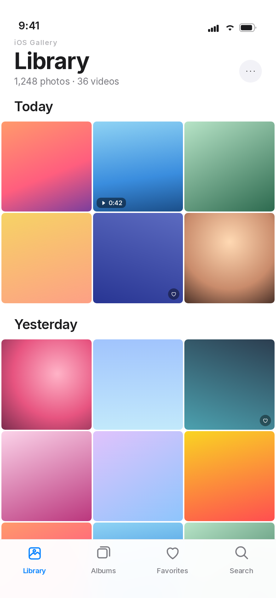
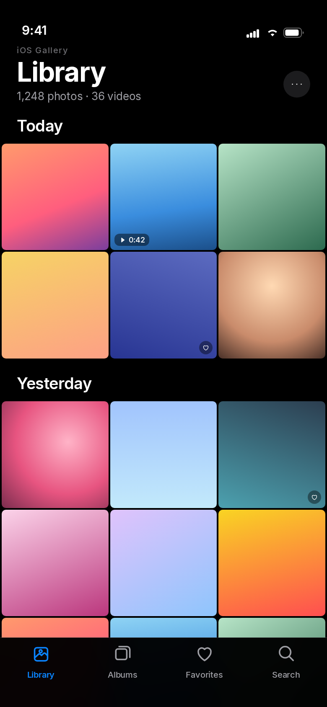
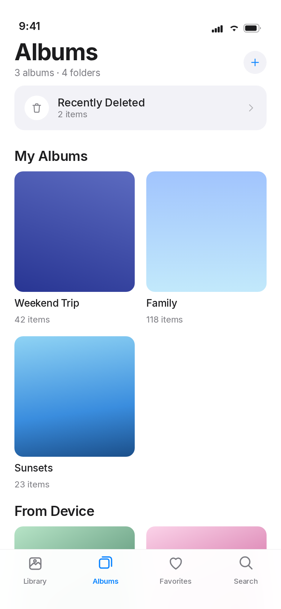
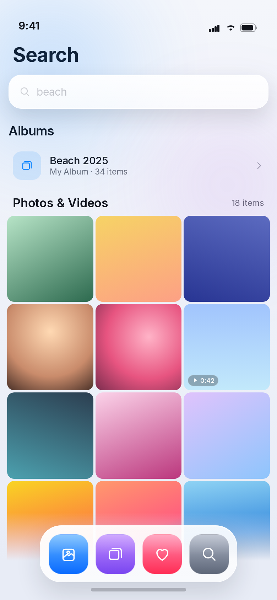
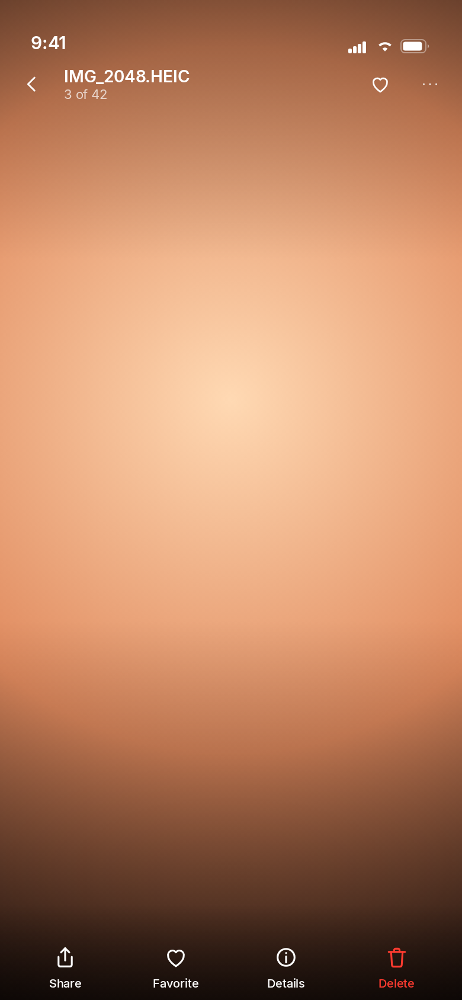
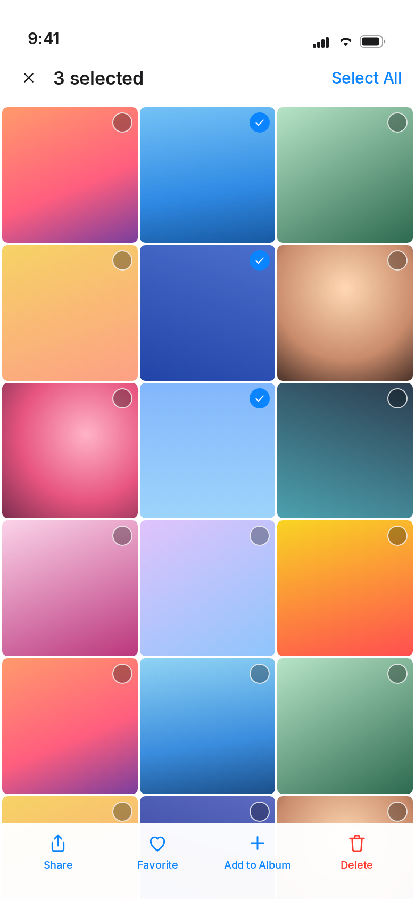
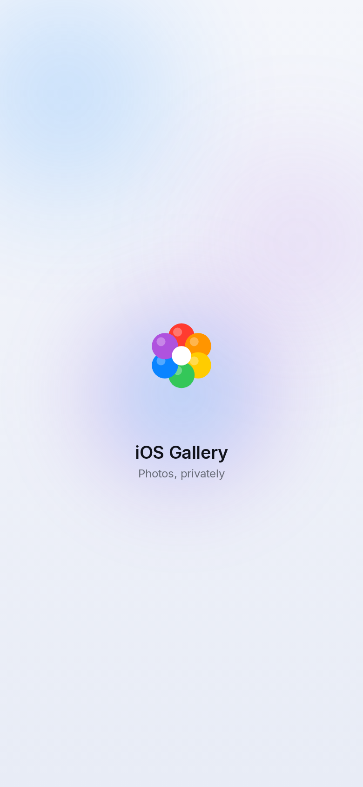

# iOS Gallery

A simple, private, **fully offline** photo and video gallery for Android, inspired by the
organisation and visual style of Apple's Photos app on iOS and macOS.

Kotlin · Jetpack Compose · Material 3 · MediaStore · Media3 · Coil — no server, no account,
no API key, no cloud, and **no `INTERNET` permission**.

The interface is built on **iOS Liquid Glass**: translucent panels that let your photos show
through, bright hairline edges, specular sheen, soft depth and spring-driven motion.

> iOS Gallery is an independent project. It is not affiliated with, endorsed by, or
> connected to Apple Inc. The name and the flower mark are original artwork.

---

## Screens

| Library (light) | Library (dark) | Albums |
| --- | --- | --- |
|  |  |  |

| Search | Photo viewer | Selection mode |
| --- | --- | --- |
|  |  |  |

| Launch animation |
| --- |
|  |

**About these images:** they are *design previews*, rendered from the same layout, spacing,
colour, glass and type tokens the Compose UI uses. The build machine for this project has no
KVM, so no Android emulator could be booted to take true device screenshots. The app itself is
the real thing — build it or install the APK and you will see these screens with your own
photos in them.

---

## Liquid Glass

Every surface is one material, built from four layers in `ui/Glass.kt`:

| Layer | What it does |
| --- | --- |
| Fill | `linear-gradient(135°)` from 38 % to 10 % white in light mode (16 % → 5 % in dark), so the photos stay visible through every panel |
| Border | 1 dp solid white at 48 % (22 % in dark) — the glass rim |
| Inset highlight | A 1 dp bright lip along the top edge (`inset 0 1px 1px rgba(255,255,255,.6)`) |
| Soft shadow | `0 8px 24px rgba(0,0,0,.13)` equivalent — wide and low, lifting the panel off the content |

On top of that:

* **Floating chrome** — the tab bar, headers, action bars, sheets and dialogs all float over
  the content instead of pinning to the screen edges.
* **Gliding capsule** — the tab bar's selection indicator springs between tabs
  (`spring(dampingRatio = 0.74, stiffness = StiffnessLow)`).
* **Press physics** — every control scales to 0.92–0.98 with a spring on touch
  (`Modifier.glassClickable`), so surfaces feel like they have weight.
* **Ambient light** — two large blurred colour blobs sit behind the UI
  (`Modifier.blur(90.dp)`, Android 12+; a plain gradient below that) so the glass has
  something to refract.
* **Motion** — see [Motion](#motion): the app zooms out of its icon and back into it, screens
  settle on springs, the tab capsule glides, and grid items animate their placement.
* **Readability first** — a soft scrim sits under every floating bar so text and icons stay
  crisp over busy photos.

## Motion

Every animation is spring- or ease-driven, short, and runs on the render thread — nothing
bounces more than a few percent and no animation blocks input.

**App open.** The launcher shows the adaptive icon (Android 12+ splash). The flower mark then
blooms in the same place, and when it finishes the gallery grows *out of* it: the content
springs from `0.90 → 1.0` scale while fading in over 320 ms. On Android 14+ the window itself
gets the same treatment through `overrideActivityTransition` (`res/anim/app_open_enter.xml`).

**App close.** Back at the top level runs the reverse: content shrinks to `0.90` and fades over
~240 ms, then the window finishes with `app_close_exit.xml` (scale `1.0 → 0.90`, fade), so the
app folds back towards its icon instead of vanishing.

**Screens.** A pushed screen settles forward — fade, `0.965 → 1.0` scale, and a 1/16 slide on a
0.9-damped spring — while the old one drifts back (fade, `1.0 → 1.015`). Popping mirrors it
exactly, so going back feels like the same movement reversed.

**Navigation options.** Switching between Library, Albums, Favorites and Search slides the
content the same way the glass capsule travels: the incoming screen enters from the side of the
tab you moved towards (`width / 7` on a 0.92-damped spring) while the outgoing one leaves the
other way (`width / 11`), both cross-fading with a `0.985 → 1.0` scale. Direction is derived from
the tab order, so moving right always feels like moving right.

**Photos.** Swiping between photos slides them with the pager's own spring settle, one photo at a
time. (An earlier build also dimmed and shrank the outgoing photo; that layer forced a full-screen
offscreen buffer and could flash the current photo, so it was removed in 1.4.)

**Viewer chrome.** The photo viewer keeps its own fixed look so it reads on any image: a **light
glass bar** at the top (filename, `3 of 42`, dark circular buttons) and a **dark glass bar** at the
bottom (Share / Favorite / Details / Delete with labels), both floating over the photo.

**Dock.** The bottom navigation is an iPhone-style dock: a floating glass pill holding four
rounded-square tiles (Library, Albums, Favorites, Search) with no labels. A 16 % white highlight
glides between tiles on `spring(dampingRatio = 0.88, stiffness = 520)` — about 300 ms with a
whisper of overshoot — while the active tile lifts to full size and brightness and the others sit
at 93 % scale. The dock fades and slides away when selection mode or a pushed screen hides it.

**Cost.** Only `graphicsLayer` scale/alpha and layout offsets animate, so frames are handled by
RenderThread: no per-frame recomposition, no bitmap work, no blur in the hot path. Durations
stay in the 140–340 ms range with no chained delays.

---

## Animated app icon

Android launchers only render static adaptive icons, so the icon animation lives where it can
actually be seen — the moment the app opens:

1. The flower's six petals bloom out one after another (65 ms stagger, 520 ms each).
2. The mark settles from 0.86 → 1.0 scale on a slow ease-out.
3. A specular highlight sweeps diagonally across the glass.
4. "iOS Gallery · Photos, privately" rises in.
5. Everything fades into the gallery, which zooms in from the mark (see [Motion](#motion)).

It is drawn entirely in Compose (`FlowerMark` + `LaunchAnimation`), needs no assets, and
respects the light/dark theme. The launcher icon itself is an adaptive icon with a monochrome
layer for Android 13 themed icons.

---

## Install

**[Download the APK](https://github.com/technicalnihilist-lgtm/ios-gallery/releases/latest)**
— 13 MB, Android 7.0+ (see the [releases page](https://github.com/technicalnihilist-lgtm/ios-gallery/releases)
for the current file).

```bash
adb install iOS-Gallery-1.7.apk
```

Or copy the file to the phone and open it, allowing "install unknown apps" when asked.

* Signed with the standard Android **debug key** (APK Signature Scheme v2), zip-aligned.
* `v1.7` is a **debug-variant** build (`debuggable=true`). The release variant needs D8 to
  dex ~40 MB of libraries in one go, which exceeded the per-command time limit of the build
  machine used here; the app itself is identical. Build `assembleRelease` locally for a
  non-debuggable APK.
* The APK is not committed to the repository — it lives on the release page, which keeps
  clone sizes small.

---

## Customize

Everything the user can change lives on one glass screen — Library header **⋯** →
**Customize appearance**:

| Control | Range | What it does |
| --- | --- | --- |
| **Dock size** | 75 % – 135 % | Scales the dock pill, tiles, gutters and icons together |
| **Glass transparency** | 30 % – 100 % | Multiplies the alpha of every glass layer (fill, border, sheen) — lower means more of your photos shows through |
| **Grid columns** | 2 – 5 | Thumbnails per row in the library, favourites, albums and search |
| **Appearance** | System / Light / Dark | Overrides the system theme |

Changes apply live — the screen shows a real dock preview as you drag — and are remembered across
launches in private SharedPreferences. **Reset** restores the defaults. Nothing leaves the device.

---

## Features

### Photos
* Automatic local scan through **MediaStore** (images + videos in one timeline).
* Evenly spaced, rounded iOS-style grid; lazy thumbnails with an in-memory + on-disk cache.
* Grouped by date: **Today**, **Yesterday**, then `12 March 2025`.
* **Years / Months / All** view switch in a floating glass capsule (5 / 4 / 3 columns).
* **Favourites only** filter and **newest / oldest** sorting from the header menu.
* Item count in the header (`1,248 photos · 36 videos`).
* Multi-select with Share / Favorite / Add to Album / Delete.

### Albums
* Every device folder appears automatically as an album, with cover thumbnail and count.
* Create, rename and delete **app-managed albums**.
* Add or remove photos from a managed album without ever touching the original file.

### Photo viewer
* Full-screen viewer with **pinch-to-zoom**, **double-tap zoom** and swipe navigation.
* Details sheet: file name, type, date, resolution, size, duration, folder.
* Share, copy, move, rename and delete through Android's own APIs:
  * **Share** — `ACTION_SEND` / `ACTION_SEND_MULTIPLE` with read grants.
  * **Copy / Move** — system folder picker (SAF), so you choose the destination.
  * **Rename** — `MediaStore` update, with `createWriteRequest` consent on Android 11+.
  * **Delete** — goes to Recently Deleted first (see below).

### Video
* Videos appear in the same grid, with duration badges and video-frame thumbnails.
* Playback with **Media3 ExoPlayer** and the native player controls (play/pause, seek,
  scrubbing, full-screen surface).

### Search
* Searches file names **and** album names, entirely on-device.
* Results split into Albums and Photos & Videos.

### Favorites
* Heart any photo or video; a dedicated Favorites tab shows them all.

### Recently Deleted
* Deleting moves an item into an app-managed trash area (a copy lives in the app's private
  storage) and then asks Android to remove the original.
* Restore puts it back into your library (`Pictures/iOS Gallery` or `Movies/iOS Gallery`).
* Delete Permanently, or Empty All, removes the app's copy for good.
* Anything older than 30 days is purged automatically.
* If the system confirmation is declined, the app rolls the trash entry back — nothing is
  left behind and nothing is lost.

---

## Privacy

| Question | Answer |
| --- | --- |
| Internet permission? | **None.** There is no `INTERNET` permission in the manifest, and the library-injected `ACCESS_NETWORK_STATE` is explicitly removed. |
| Accounts / login? | None. |
| Analytics / ads / trackers? | None. |
| Cloud sync / backup? | None. Backups and device transfer are disabled in the manifest. |
| Where is my media? | Exactly where it already was. The app only reads MediaStore. |
| What does the app write? | A small JSON index (favourites, albums, trash list) and thumbnail cache in its own private storage, plus a copy of items you delete. |

Permission handling:

| Android | Permission requested |
| --- | --- |
| 14–16 (API 34+) | `READ_MEDIA_IMAGES`, `READ_MEDIA_VIDEO`, `READ_MEDIA_VISUAL_USER_SELECTED` (supports "Select photos" partial access) |
| 13 (API 33) | `READ_MEDIA_IMAGES`, `READ_MEDIA_VIDEO` |
| 7–12L (API 24–32) | `READ_EXTERNAL_STORAGE` (+ `WRITE_EXTERNAL_STORAGE`, only needed to restore trashed items on those releases) |

If access is denied the app explains why, offers to ask again, and offers a shortcut to
system settings when the request can no longer be shown.

Works in airplane mode, always.

---

## Performance

* One MediaStore query per media type; no background services, no periodic jobs.
* Cursor columns are read defensively — a missing column or a revoked permission can't crash
  the scan (every query is wrapped and returns what it could read).
* Thumbnails are decoded at view size by Coil with a 20 % memory cache and a 200 MB disk cache.
* `LazyVerticalGrid` with stable keys and an adaptive column count, so thousands of items
  scroll without holding bitmaps in memory.
* The video player is created only for the visible page and released immediately.

---

## Build

Requirements: JDK 17, Android SDK Platform 35 + Build-Tools 35.0.0.

```bash
git clone <this repo>
cd iOS-Gallery
echo "sdk.dir=$HOME/Android/Sdk" > local.properties   # or set ANDROID_HOME
./gradlew assembleDebug        # app/build/outputs/apk/debug/app-debug.apk
./gradlew assembleRelease      # app/build/outputs/apk/release/app-release.apk
```

Signing your own release build:

```kotlin
// app/build.gradle.kts
signingConfigs {
    create("release") {
        storeFile = file("keystore.jks")
        storePassword = System.getenv("KEYSTORE_PASSWORD")
        keyAlias = System.getenv("KEY_ALIAS")
        keyPassword = System.getenv("KEY_PASSWORD")
    }
}
buildTypes { release { signingConfig = signingConfigs.getByName("release") } }
```

Then install:

```bash
adb install -r app/build/outputs/apk/release/app-release.apk
```

Notes:
* `isMinifyEnabled = false` — R8 shrinking is deliberately off so the build is quick and
  reproducible; the APK is ~9 MB either way.
* `lint { checkReleaseBuilds = false }` keeps release builds fast.
* `resourceConfigurations += listOf("en")` — the UI is English only, by design.

---

## Project layout

```
app/src/main/java/com/hubclub/iosgallery/
├── MainActivity.kt          app shell, permission gate, bottom navigation
├── GalleryApp.kt            thumbnail ImageLoader (memory + disk cache)
├── data/
│   ├── MediaRepository.kt   MediaStore scanning, device album grouping
│   ├── MetaStore.kt         favourites, managed albums, trash index (JSON)
│   └── FileOps.kt           share / copy / move / rename / delete / trash / restore
├── model/Models.kt          MediaItem, DeviceAlbum, ManagedAlbum, TrashEntry
├── ui/
│   ├── GalleryViewModel.kt  state + actions
│   ├── LibraryScreen.kt     timeline grid, date headers, selection mode
│   ├── AlbumsScreen.kt      albums, album detail, photo picker, dialogs
│   ├── FavoritesScreen.kt   favorites grid
│   ├── SearchScreen.kt      offline filename / album search
│   ├── ViewerScreen.kt      pager, pinch-zoom, video page, details sheet
│   ├── TrashScreen.kt       Recently Deleted
│   ├── Glass.kt             liquid-glass material, press physics, icon + launch animation
│   ├── Components.kt        grid, thumbnails, floating tab bar, glass sheets
│   ├── GalleryIcons.kt      hand-built line icons (no icon-font dependency)
│   └── theme/Theme.kt       light / dark palettes and typography
└── util/                    permissions, formatting, date grouping
```

---

## Design notes

* Light theme: `#F4F6FB → #E8ECF6` ambient background, glass fill `rgba(255,255,255,0.88→0.70)`,
  single accent `#0A84FF`. Dark theme: near-black `#0A0A0C`, charcoal glass, accent `#4DA3FF`.
* The dock is a 278 × 80 dp glass pill (30 dp radius) floating 12 dp above the system navigation
  inset, holding four 56 dp tiles with a 17 dp radius and 10 dp gutters. Each section has its own
  two-stop gradient in the spirit of iOS app icons: blue for Library, violet for Albums, pink for
  Favorites, graphite for Search.
* Thumbnails are 10 dp rounded tiles with a 3 dp gutter and a 0.05-alpha white wash on top, so
  the grid reads as one continuous material.
* Icons are drawn as vector paths in code (`ui/GalleryIcons.kt`) — no icon-font dependency, and
  every glyph shares the 1.7 dp stroke weight.
* The app icon is an original multicoloured flower / aperture mark, generated as an adaptive
  icon with a monochrome layer plus legacy raster fallbacks.

## Fixed in 1.4

* **Blank flash when opening a photo.** The viewer overlay wrote snapshot state during
  composition (`lastRequest = request`), so the first frame composed with no request and the photo
  appeared one frame late. It now reads `request ?: lastRequest` and keeps the last value through a
  `SideEffect`.
* **Photo could open dimmed / shifted.** The per-page parallax layer scaled, translated and
  dimmed the current photo whenever the pager's `currentPage` and the composed page disagreed for
  a frame. Removed.
* **Swiping could stop working after zooming.** The `zoomed` flag was never cleared on a page
  change, leaving `userScrollEnabled = false`. It is now reset by
  `LaunchedEffect(pagerState.currentPage)`.
* **Gallery could stay invisible.** The whole app sat inside a permanent scaled/alpha layer, which
  also breaks `SurfaceView` (video). The layer now exists only while the open/close animation
  runs, and a 2.6 s watchdog forces the content visible if the launch animation never finishes.
* **The open zoom happened behind an opaque overlay**, so it was never actually visible. The launch
  mark now hands over *while* it dissolves, so the gallery visibly grows out of the icon.

## Known limitations

* No device or emulator run was possible in the build environment (no KVM), so the UI has
  been verified by compilation, resource/manifest inspection and the rendered previews —
  not by tapping through it on hardware.
* Renaming or deleting files owned by another app requires the Android confirmation dialog;
  if it is declined the operation is cancelled cleanly.
* Restoring a trashed item on Android 7–12L needs write access, which the app requests on
  those releases only.
* The UI is English only.
* `Modifier.blur` is a no-op below Android 12, so the ambient light blobs become flat
  gradients there; the glass panels themselves look the same on every version.
* Compose cannot sample the content behind a composable, so panels use translucency + sheen +
  scrim rather than a true backdrop blur. The result reads as frosted glass without the cost of
  rendering the grid twice.

---

## Licence

MIT — see [LICENSE](LICENSE).

Trademark note: iOS Gallery is an independent project and is not affiliated with, endorsed by
or connected to Apple Inc. "iOS", "iPhone", "iPad" and "macOS" are trademarks of Apple Inc.
The flower/aperture app icon is original artwork created for this project and is not Apple's
Photos icon.

---

## ⭐ Like this work? Give it a star

If you like this app and our work, please **star this repository** ⭐ and **[follow technicalnihilist-lgtm on GitHub](https://github.com/technicalnihilist-lgtm)**. If our work isn't for you, that's completely fine — the choice is yours. Thank you for stopping by!

<details>
<summary><b>🌍 Same message in 32 languages (A–Z + Indian languages)</b></summary>

- **A — Arabic** (العربية): ⭐ إذا أعجبك هذا التطبيق وعملنا، فيرجى منح المستودع نجمة ومتابعتنا. وإذا لم يعجبك عملنا، فلا مشكلة على الإطلاق — القرار قرارك. شكرًا لزيارتك!
- **B — Bengali** (বাংলা): ⭐ যদি আপনার এই অ্যাপ এবং আমাদের কাজ ভালো লাগে, তবে অনুগ্রহ করে রিপোজিটরিটিকে একটি স্টার দিন এবং আমাদের ফলো করুন। আমাদের কাজ যদি আপনার পছন্দ না হয়, তাতেও কোনো সমস্যা নেই — সিদ্ধান্ত আপনার। আমাদের পেজে আসার জন্য ধন্যবাদ!
- **C — Chinese** (中文): ⭐ 如果你喜欢这个应用和我们的作品，请给仓库点个星标并关注我们。如果我们的作品不适合你，也完全没关系——选择权在你。感谢你的到访！
- **D — Dutch** (Nederlands): ⭐ Vind je deze app en ons werk leuk? Geef de repository dan een ster en volg ons. Vind je ons werk niets, dan is dat helemaal prima — de keuze is aan jou. Bedankt voor je bezoek!
- **E — English** (English): ⭐ If you like this app and our work, please give the repository a star and follow us. If our work isn't for you, that's completely fine — the choice is yours. Thank you for stopping by!
- **F — French** (Français): ⭐ Si cette application et notre travail vous plaisent, mettez une étoile au dépôt et suivez-nous. Si notre travail n'est pas pour vous, aucun souci — c'est votre choix. Merci de votre visite !
- **G — German** (Deutsch): ⭐ Wenn dir diese App und unsere Arbeit gefallen, gib dem Repository einen Stern und folge uns. Wenn unsere Arbeit nichts für dich ist, ist das völlig in Ordnung — die Wahl liegt bei dir. Danke fürs Vorbeischauen!
- **H — Hindi** (हिन्दी): ⭐ अगर आपको यह ऐप और हमारा काम पसंद है, तो कृपया रिपॉजिटरी को स्टार दें और हमें फॉलो करें। अगर हमारा काम आपके लिए नहीं है, तो भी कोई बात नहीं — यह पूरी तरह आपकी मर्ज़ी है। यहाँ आने के लिए आपका धन्यवाद!
- **I — Indonesian** (Bahasa Indonesia): ⭐ Jika kamu suka aplikasi ini dan karya kami, beri bintang pada repositori ini dan ikuti kami. Kalau karya kami bukan untukmu, tidak masalah sama sekali — itu pilihanmu. Terima kasih sudah mampir!
- **J — Japanese** (日本語): ⭐ このアプリと私たちの仕事が気に入ったら、リポジトリにスターを付けてフォローしてください。合わない場合はまったく問題ありません — 選ぶのはあなたです。お越しいただきありがとうございます！
- **K — Korean** (한국어): ⭐ 이 앱과 저희 작업이 마음에 드신다면 저장소에 스타를 눌러 주시고 팔로우해 주세요. 저희 작업이 맞지 않으셔도 전혀 괜찮습니다 — 선택은 여러분의 몫입니다. 방문해 주셔서 감사합니다!
- **L — Lithuanian** (Lietuvių): ⭐ Jei tau patinka ši programa ir mūsų darbas, duok saugyklai žvaigždutę ir sek mus. Jei mūsų darbas ne tau, viskas gerai — pasirinkimas tavo. Ačiū, kad užsukai!
- **M — Malayalam** (മലയാളം): ⭐ നിങ്ങൾക്ക് ഈ ആപ്പും ഞങ്ങളുടെ പ്രവർത്തനവും ഇഷ്ടപ്പെട്ടെങ്കിൽ, ദയവായി റെപ്പോസിറ്ററിക്ക് ഒരു സ്റ്റാർ നൽകുകയും ഞങ്ങളെ ഫോളോ ചെയ്യുകയും ചെയ്യുക. ഞങ്ങളുടെ പ്രവർത്തനം നിങ്ങൾക്ക് അനുയോജ്യമല്ലെങ്കിൽ, അതും തികച്ചും കുഴപ്പമില്ല — തീരുമാനം നിങ്ങളുടേതാണ്. ഇവിടെ വന്നതിന് നന്ദി!
- **N — Nepali** (नेपाली): ⭐ यदि तपाईंलाई यो एप र हाम्रो काम मन पर्‍यो भने, कृपया रिपोजिटरीलाई स्टार दिनुहोस् र हामीलाई फलो गर्नुहोस्। यदि हाम्रो काम तपाईंलाई मन पर्दैन भने, पनि ठीकै छ — यो तपाईंको इच्छा हो। यहाँ आउनुभएकोमा धन्यवाद!
- **O — Odia** (ଓଡ଼ିଆ): ⭐ ଯଦି ଆପଣଙ୍କୁ ଏହି ଆପ୍ ଏବଂ ଆମର କାମ ଭଲ ଲାଗୁଛି, ତେବେ ଦୟାକରି ରିପୋଜିଟୋରୀକୁ ଗୋଟିଏ ଷ୍ଟାର୍ ଦିଅନ୍ତୁ ଏବଂ ଆମକୁ ଫଲୋ କରନ୍ତୁ। ଯଦି ଆମର କାମ ଆପଣଙ୍କ ପାଇଁ ନୁହେଁ, ତେବେ କିଛି ଅସୁବିଧା ନାହିଁ — ପସନ୍ଦ ଆପଣଙ୍କର। ଆମ ପାଖକୁ ଆସିଥିବାରୁ ଧନ୍ୟବାଦ!
- **P — Polish** (Polski): ⭐ Jeśli podoba Ci się ta aplikacja i nasza praca, daj repozytorium gwiazdkę i obserwuj nas. Jeśli nasza praca nie jest dla Ciebie, to zupełnie w porządku — wybór należy do Ciebie. Dziękujemy za odwiedziny!
- **Q — Quechua** (Runa Simi): ⭐ Kay app, ñuqaykup ruwasqanchikpas gustasunki chayqa, repositorioman huk estrella churay, ñuqaykutapas qatipayku. Mana gustasunki chayqa, allinmi — qampa akllayki. Hamusqaykimanta sulpayki!
- **R — Russian** (Русский): ⭐ Если вам нравится это приложение и наша работа, поставьте звёздочку репозиторию и подпишитесь на нас. Если наша работа не для вас — это совершенно нормально, выбор за вами. Спасибо, что заглянули!
- **S — Spanish** (Español): ⭐ Si te gusta esta app y nuestro trabajo, dale una estrella al repositorio y síguenos. Si nuestro trabajo no es para ti, no pasa nada — la decisión es tuya. ¡Gracias por pasarte!
- **T — Tamil** (தமிழ்): ⭐ உங்களுக்கு இந்த ஆப்பும் எங்க வேலையும் பிடிச்சிருந்தா, தயவுசெஞ்சு இந்த ரெபாசிட்டரிக்கு ஒரு ஸ்டார் குடுத்து, எங்களை ஃபாலோ பண்ணுங்க. எங்க வேலை உங்களுக்கு செட் ஆகலைன்னாலும் பரவாயில்லை — அது உங்க விருப்பம். இங்கே வந்ததுக்கு நன்றி!
- **U — Urdu** (اردو): ⭐ اگر آپ کو یہ ایپ اور ہمارا کام پسند آئے تو براہ کرم ریپازٹری کو سٹار دیں اور ہمیں فالو کریں۔ اگر ہمارا کام آپ کے لیے نہیں ہے، تو یہ بالکل ٹھیک ہے — انتخاب آپ کا ہے۔ یہاں تشریف لانے کا شکریہ!
- **V — Vietnamese** (Tiếng Việt): ⭐ Nếu bạn thích ứng dụng này và công việc của chúng tôi, hãy tặng kho lưu trữ một ngôi sao và theo dõi chúng tôi. Nếu công việc của chúng tôi không phù hợp với bạn, điều đó hoàn toàn ổn — lựa chọn là của bạn. Cảm ơn bạn đã ghé qua!
- **W — Welsh** (Cymraeg): ⭐ Os ydych chi'n hoffi'r ap hwn a'n gwaith, rhowch seren i'r storfa a dilynwch ni. Os nad yw ein gwaith ar eich cyfer, mae hynny'n hollol iawn — chi sydd i benderfynu. Diolch am alw heibio!
- **X — Xhosa** (isiXhosa): ⭐ Ukuba uyayithanda le app nomsebenzi wethu, nika irepo inkwenkwezi kwaye usilandele. Ukuba umsebenzi wethu awukufanelanga, akukho ngxaki — lukhetho lwakho. Enkosi ngokutyelela!
- **Y — Yoruba** (Yorùbá): ⭐ Bí app yìí àti iṣẹ́ wa bá wù ọ́, jọ̀wọ́ fún àkójọpọ̀ náà ní ìràwọ̀ kí o sì tẹ̀lé wa. Bí iṣẹ́ wa kò bá yẹ ọ́, kò séwu — ìwọ ni ó yàn. Ẹ ṣé fún wíwá!
- **Z — Zulu** (isiZulu): ⭐ Uma uthanda le app nomsebenzi wethu, nikeza isitoreji inkanyezi bese usilandela. Uma umsebenzi wethu ungakufanele, akunankinga — wukukhetha kwakho. Siyabonga ngokuvakasha!

**More Indian languages**

- **Assamese** (অসমীয়া): ⭐ যদি আপুনি এই এপটো আৰু আমাৰ কাম ভাল পায়, তেন্তে অনুগ্ৰহ কৰি ৰিপজিটৰীটোক এটা ষ্টাৰ দিয়ক আৰু আমাক ফ'ল' কৰক। যদি আমাৰ কাম আপোনাৰ বাবে নহয়, তেন্তে সেয়া একেবাৰে ঠিক আছে — সিদ্ধান্তটো আপোনাৰ। আমাৰ ইয়ালৈ অহাৰ বাবে ধন্যবাদ!
- **Gujarati** (ગુજરાતી): ⭐ જો તમને આ એપ અને અમારું કામ ગમતું હોય, તો પ્લીઝ રિપોઝિટરીને સ્ટાર આપો અને અમને ફોલો કરો. જો અમારું કામ તમને ન ગમતું હોય, તો તે પણ બરાબર છે — પસંદગી તમારી છે. અહીં આવવા બદલ આભાર!
- **Kannada** (ಕನ್ನಡ): ⭐ ನಿಮಗೆ ಈ ಆ್ಯಪ್ ಮತ್ತು ನಮ್ಮ ಕೆಲಸ ಇಷ್ಟವಾದರೆ, ದಯವಿಟ್ಟು ರೆಪೊಸಿಟರಿಗೆ ಸ್ಟಾರ್ ಕೊಡಿ ಮತ್ತು ನಮ್ಮನ್ನು ಫಾಲೋ ಮಾಡಿ. ನಮ್ಮ ಕೆಲಸ ನಿಮಗೆ ಸರಿಹೊಂದದಿದ್ದರೆ, ಅದೂ ಪರವಾಗಿಲ್ಲ — ಆಯ್ಕೆ ನಿಮ್ಮದು. ಭೇಟಿ ನೀಡಿದ್ದಕ್ಕೆ ಧನ್ಯವಾದಗಳು!
- **Marathi** (मराठी): ⭐ जर तुम्हाला हे ॲप आणि आमचं काम आवडलं असेल, तर कृपया रिपॉझिटरीला स्टार द्या आणि आम्हाला फॉलो करा. जर आमचं काम तुम्हाला आवडत नसेल, तर काही हरकत नाही — ती तुमची निवड आहे. इथे आल्याबद्दल धन्यवाद!
- **Punjabi** (ਪੰਜਾਬੀ): ⭐ ਜੇ ਤੁਹਾਨੂੰ ਇਹ ਐਪ ਅਤੇ ਸਾਡਾ ਕੰਮ ਪਸੰਦ ਹੈ, ਤਾਂ ਕਿਰਪਾ ਕਰਕੇ ਰਿਪੋਜ਼ਟਰੀ ਨੂੰ ਸਟਾਰ ਦਿਓ ਅਤੇ ਸਾਨੂੰ ਫਾਲੋ ਕਰੋ। ਜੇ ਸਾਡਾ ਕੰਮ ਤੁਹਾਡੇ ਲਈ ਨਹੀਂ ਹੈ, ਤਾਂ ਕੋਈ ਗੱਲ ਨਹੀਂ — ਚੋਣ ਤੁਹਾਡੀ ਹੈ। ਸਾਡੇ ਪੇਜ 'ਤੇ ਆਉਣ ਲਈ ਧੰਨਵਾਦ!
- **Telugu** (తెలుగు): ⭐ మీకు ఈ యాప్, మా పని నచ్చితే, దయచేసి రిపోజిటరీకి ఒక స్టార్ ఇచ్చి మమ్మల్ని ఫాలో అవ్వండి. ఒకవేళ మా పని మీకు నచ్చకపోతే, పర్వాలేదు — అది మీ ఇష్టం. మమ్మల్ని సందర్శించినందుకు ధన్యవాదాలు!

</details>
