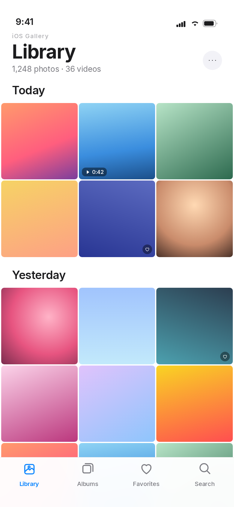
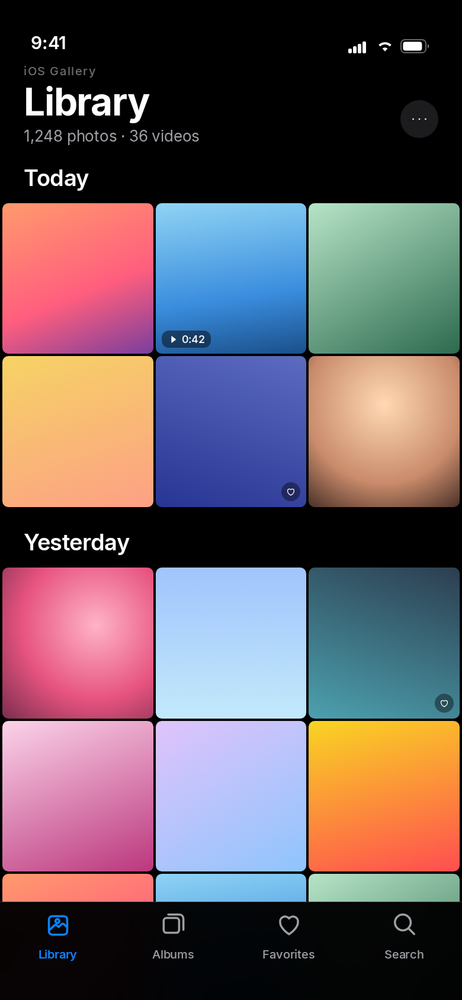
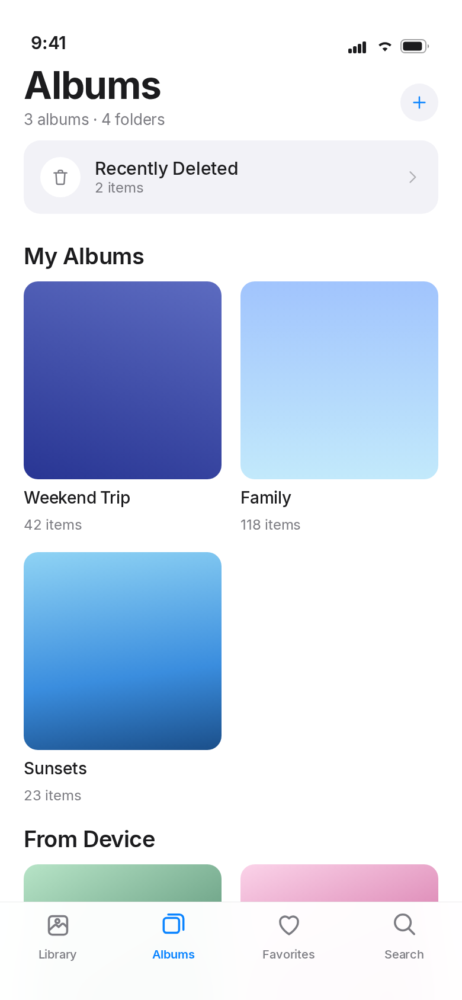
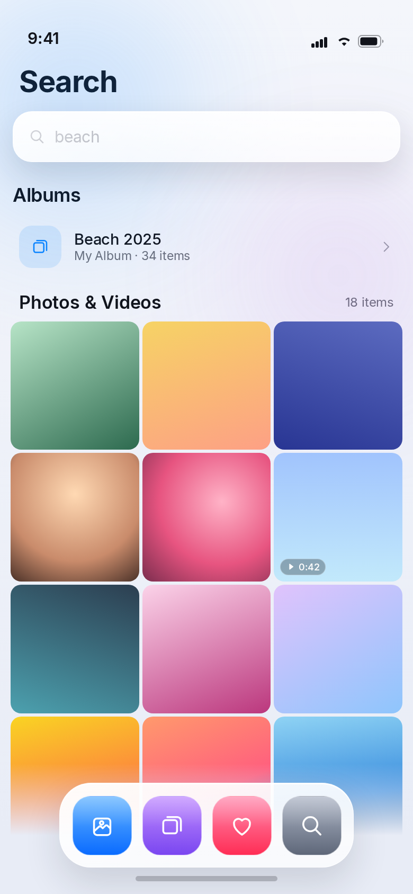
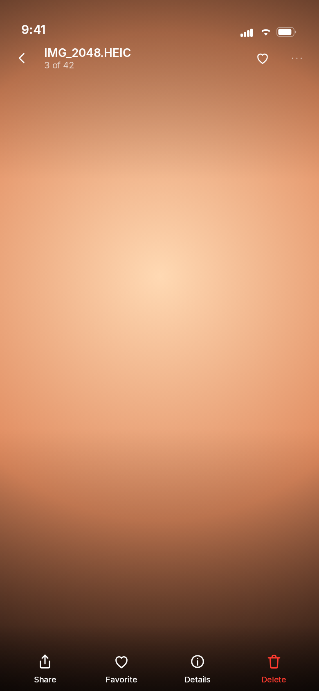
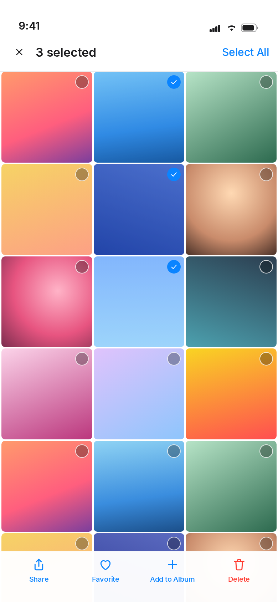
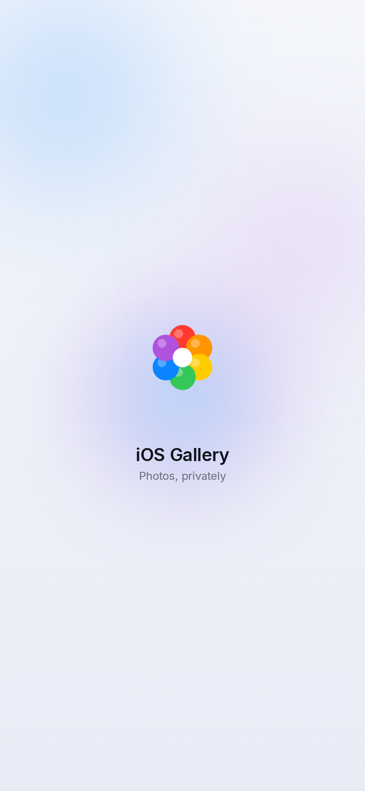

# iOS Gallery

A simple, private, **fully offline** photo and video gallery for Android, inspired by the
organisation and visual style of Apple's Photos app on iOS and macOS.

Kotlin · Jetpack Compose · Material 3 · MediaStore · Media3 · Coil — no server, no account,
no API key, no cloud, and **no `INTERNET` permission**.

The interface is built on **iOS Liquid Glass**: translucent panels that let your photos show
through, bright hairline edges, specular sheen, soft depth and spring-driven motion.

> iOS Gallery is an independent project. It is not affiliated with, endorsed by, or
> connected to Apple Inc. The name and the flower mark are original artwork.

---

## Screens

| Library (light) | Library (dark) | Albums |
| --- | --- | --- |
|  |  |  |

| Search | Photo viewer | Selection mode |
| --- | --- | --- |
|  |  |  |

| Launch animation |
| --- |
|  |

**About these images:** they are *design previews*, rendered from the same layout, spacing,
colour, glass and type tokens the Compose UI uses. The build machine for this project has no
KVM, so no Android emulator could be booted to take true device screenshots. The app itself is
the real thing — build it or install the APK and you will see these screens with your own
photos in them.

---

## Liquid Glass

Every surface is one material, built from four layers in `ui/Glass.kt`:

| Layer | What it does |
| --- | --- |
| Translucent fill | `linear-gradient` from 88 % to 70 % white (light) or 72 % → 62 % charcoal (dark), so the photo grid stays visible through every panel |
| Hairline border | 0.9 dp border that is bright at the top edge and fades towards the bottom — the glass "lip" |
| Specular sheen | A diagonal white gradient across the top-left corner, like light hitting the surface |
| Soft shadow | Low-opacity, wide drop shadow that lifts the panel off the content |

On top of that:

* **Floating chrome** — the tab bar, headers, action bars, sheets and dialogs all float over
  the content instead of pinning to the screen edges.
* **Gliding capsule** — the tab bar's selection indicator springs between tabs
  (`spring(dampingRatio = 0.74, stiffness = StiffnessLow)`).
* **Press physics** — every control scales to 0.92–0.98 with a spring on touch
  (`Modifier.glassClickable`), so surfaces feel like they have weight.
* **Ambient light** — two large blurred colour blobs sit behind the UI
  (`Modifier.blur(90.dp)`, Android 12+; a plain gradient below that) so the glass has
  something to refract.
* **Motion** — see [Motion](#motion): the app zooms out of its icon and back into it, screens
  settle on springs, the tab capsule glides, and grid items animate their placement.
* **Readability first** — a soft scrim sits under every floating bar so text and icons stay
  crisp over busy photos.

## Motion

Every animation is spring- or ease-driven, short, and runs on the render thread — nothing
bounces more than a few percent and no animation blocks input.

**App open.** The launcher shows the adaptive icon (Android 12+ splash). The flower mark then
blooms in the same place, and when it finishes the gallery grows *out of* it: the content
springs from `0.90 → 1.0` scale while fading in over 320 ms. On Android 14+ the window itself
gets the same treatment through `overrideActivityTransition` (`res/anim/app_open_enter.xml`).

**App close.** Back at the top level runs the reverse: content shrinks to `0.90` and fades over
~240 ms, then the window finishes with `app_close_exit.xml` (scale `1.0 → 0.90`, fade), so the
app folds back towards its icon instead of vanishing.

**Screens.** A pushed screen settles forward — fade, `0.965 → 1.0` scale, and a 1/16 slide on a
0.9-damped spring — while the old one drifts back (fade, `1.0 → 1.015`). Popping mirrors it
exactly, so going back feels like the same movement reversed.

**Tabs.** Cross-fade with a `0.99 → 1.0` scale, 220 ms in / 140 ms out.

**Bottom bar.** The blue translucent capsule glides between tabs on
`spring(dampingRatio = 0.88, stiffness = 520)` — about 300 ms with a whisper of overshoot — and
the icon and label tints cross-fade over 260 ms so the active indicator stays in step with the
capsule. The bar fades and slides when selection mode or a pushed screen hides it.

**Cost.** Only `graphicsLayer` scale/alpha and layout offsets animate, so frames are handled by
RenderThread: no per-frame recomposition, no bitmap work, no blur in the hot path. Durations
stay in the 140–340 ms range with no chained delays.

---

## Animated app icon

Android launchers only render static adaptive icons, so the icon animation lives where it can
actually be seen — the moment the app opens:

1. The flower's six petals bloom out one after another (65 ms stagger, 520 ms each).
2. The mark settles from 0.86 → 1.0 scale on a slow ease-out.
3. A specular highlight sweeps diagonally across the glass.
4. "iOS Gallery · Photos, privately" rises in.
5. Everything fades into the gallery, which zooms in from the mark (see [Motion](#motion)).

It is drawn entirely in Compose (`FlowerMark` + `LaunchAnimation`), needs no assets, and
respects the light/dark theme. The launcher icon itself is an adaptive icon with a monochrome
layer for Android 13 themed icons.

---

## Install

**[Download the APK](https://github.com/technicalnihilist-lgtm/ios-gallery/releases/latest)**
— 13 MB, Android 7.0+ (see the [releases page](https://github.com/technicalnihilist-lgtm/ios-gallery/releases)
for the current file).

```bash
adb install iOS-Gallery-1.2.apk
```

Or copy the file to the phone and open it, allowing "install unknown apps" when asked.

* Signed with the standard Android **debug key** (APK Signature Scheme v2), zip-aligned.
* `v1.2` is a **debug-variant** build (`debuggable=true`). The release variant needs D8 to
  dex ~40 MB of libraries in one go, which exceeded the per-command time limit of the build
  machine used here; the app itself is identical. Build `assembleRelease` locally for a
  non-debuggable APK.
* The APK is not committed to the repository — it lives on the release page, which keeps
  clone sizes small.

---

## Features

### Photos
* Automatic local scan through **MediaStore** (images + videos in one timeline).
* Evenly spaced, rounded iOS-style grid; lazy thumbnails with an in-memory + on-disk cache.
* Grouped by date: **Today**, **Yesterday**, then `12 March 2025`.
* Item count in the header (`1,248 photos · 36 videos`).
* Multi-select with Share / Favorite / Add to Album / Delete.

### Albums
* Every device folder appears automatically as an album, with cover thumbnail and count.
* Create, rename and delete **app-managed albums**.
* Add or remove photos from a managed album without ever touching the original file.

### Photo viewer
* Full-screen viewer with **pinch-to-zoom**, **double-tap zoom** and swipe navigation.
* Details sheet: file name, type, date, resolution, size, duration, folder.
* Share, copy, move, rename and delete through Android's own APIs:
  * **Share** — `ACTION_SEND` / `ACTION_SEND_MULTIPLE` with read grants.
  * **Copy / Move** — system folder picker (SAF), so you choose the destination.
  * **Rename** — `MediaStore` update, with `createWriteRequest` consent on Android 11+.
  * **Delete** — goes to Recently Deleted first (see below).

### Video
* Videos appear in the same grid, with duration badges and video-frame thumbnails.
* Playback with **Media3 ExoPlayer** and the native player controls (play/pause, seek,
  scrubbing, full-screen surface).

### Search
* Searches file names **and** album names, entirely on-device.
* Results split into Albums and Photos & Videos.

### Favorites
* Heart any photo or video; a dedicated Favorites tab shows them all.

### Recently Deleted
* Deleting moves an item into an app-managed trash area (a copy lives in the app's private
  storage) and then asks Android to remove the original.
* Restore puts it back into your library (`Pictures/iOS Gallery` or `Movies/iOS Gallery`).
* Delete Permanently, or Empty All, removes the app's copy for good.
* Anything older than 30 days is purged automatically.
* If the system confirmation is declined, the app rolls the trash entry back — nothing is
  left behind and nothing is lost.

---

## Privacy

| Question | Answer |
| --- | --- |
| Internet permission? | **None.** There is no `INTERNET` permission in the manifest, and the library-injected `ACCESS_NETWORK_STATE` is explicitly removed. |
| Accounts / login? | None. |
| Analytics / ads / trackers? | None. |
| Cloud sync / backup? | None. Backups and device transfer are disabled in the manifest. |
| Where is my media? | Exactly where it already was. The app only reads MediaStore. |
| What does the app write? | A small JSON index (favourites, albums, trash list) and thumbnail cache in its own private storage, plus a copy of items you delete. |

Permission handling:

| Android | Permission requested |
| --- | --- |
| 14–16 (API 34+) | `READ_MEDIA_IMAGES`, `READ_MEDIA_VIDEO`, `READ_MEDIA_VISUAL_USER_SELECTED` (supports "Select photos" partial access) |
| 13 (API 33) | `READ_MEDIA_IMAGES`, `READ_MEDIA_VIDEO` |
| 7–12L (API 24–32) | `READ_EXTERNAL_STORAGE` (+ `WRITE_EXTERNAL_STORAGE`, only needed to restore trashed items on those releases) |

If access is denied the app explains why, offers to ask again, and offers a shortcut to
system settings when the request can no longer be shown.

Works in airplane mode, always.

---

## Performance

* One MediaStore query per media type; no background services, no periodic jobs.
* Cursor columns are read defensively — a missing column or a revoked permission can't crash
  the scan (every query is wrapped and returns what it could read).
* Thumbnails are decoded at view size by Coil with a 20 % memory cache and a 200 MB disk cache.
* `LazyVerticalGrid` with stable keys and an adaptive column count, so thousands of items
  scroll without holding bitmaps in memory.
* The video player is created only for the visible page and released immediately.

---

## Build

Requirements: JDK 17, Android SDK Platform 35 + Build-Tools 35.0.0.

```bash
git clone <this repo>
cd iOS-Gallery
echo "sdk.dir=$HOME/Android/Sdk" > local.properties   # or set ANDROID_HOME
./gradlew assembleDebug        # app/build/outputs/apk/debug/app-debug.apk
./gradlew assembleRelease      # app/build/outputs/apk/release/app-release.apk
```

Signing your own release build:

```kotlin
// app/build.gradle.kts
signingConfigs {
    create("release") {
        storeFile = file("keystore.jks")
        storePassword = System.getenv("KEYSTORE_PASSWORD")
        keyAlias = System.getenv("KEY_ALIAS")
        keyPassword = System.getenv("KEY_PASSWORD")
    }
}
buildTypes { release { signingConfig = signingConfigs.getByName("release") } }
```

Then install:

```bash
adb install -r app/build/outputs/apk/release/app-release.apk
```

Notes:
* `isMinifyEnabled = false` — R8 shrinking is deliberately off so the build is quick and
  reproducible; the APK is ~9 MB either way.
* `lint { checkReleaseBuilds = false }` keeps release builds fast.
* `resourceConfigurations += listOf("en")` — the UI is English only, by design.

---

## Project layout

```
app/src/main/java/com/hubclub/iosgallery/
├── MainActivity.kt          app shell, permission gate, bottom navigation
├── GalleryApp.kt            thumbnail ImageLoader (memory + disk cache)
├── data/
│   ├── MediaRepository.kt   MediaStore scanning, device album grouping
│   ├── MetaStore.kt         favourites, managed albums, trash index (JSON)
│   └── FileOps.kt           share / copy / move / rename / delete / trash / restore
├── model/Models.kt          MediaItem, DeviceAlbum, ManagedAlbum, TrashEntry
├── ui/
│   ├── GalleryViewModel.kt  state + actions
│   ├── LibraryScreen.kt     timeline grid, date headers, selection mode
│   ├── AlbumsScreen.kt      albums, album detail, photo picker, dialogs
│   ├── FavoritesScreen.kt   favorites grid
│   ├── SearchScreen.kt      offline filename / album search
│   ├── ViewerScreen.kt      pager, pinch-zoom, video page, details sheet
│   ├── TrashScreen.kt       Recently Deleted
│   ├── Glass.kt             liquid-glass material, press physics, icon + launch animation
│   ├── Components.kt        grid, thumbnails, floating tab bar, glass sheets
│   ├── GalleryIcons.kt      hand-built line icons (no icon-font dependency)
│   └── theme/Theme.kt       light / dark palettes and typography
└── util/                    permissions, formatting, date grouping
```

---

## Design notes

* Light theme: `#F4F6FB → #E8ECF6` ambient background, glass fill `rgba(255,255,255,0.88→0.70)`,
  single accent `#0A84FF`. Dark theme: near-black `#0A0A0C`, charcoal glass, accent `#4DA3FF`.
* The tab bar is a 62 dp glass pill with a 28 dp radius, floating 10 dp above the system
  navigation inset; the selection capsule is 22 dp with a white hairline.
* Thumbnails are 10 dp rounded tiles with a 3 dp gutter and a 0.05-alpha white wash on top, so
  the grid reads as one continuous material.
* Icons are drawn as vector paths in code (`ui/GalleryIcons.kt`) — no icon-font dependency, and
  every glyph shares the 1.7 dp stroke weight.
* The app icon is an original multicoloured flower / aperture mark, generated as an adaptive
  icon with a monochrome layer plus legacy raster fallbacks.

## Known limitations

* No device or emulator run was possible in the build environment (no KVM), so the UI has
  been verified by compilation, resource/manifest inspection and the rendered previews —
  not by tapping through it on hardware.
* Renaming or deleting files owned by another app requires the Android confirmation dialog;
  if it is declined the operation is cancelled cleanly.
* Restoring a trashed item on Android 7–12L needs write access, which the app requests on
  those releases only.
* The UI is English only.
* `Modifier.blur` is a no-op below Android 12, so the ambient light blobs become flat
  gradients there; the glass panels themselves look the same on every version.
* Compose cannot sample the content behind a composable, so panels use translucency + sheen +
  scrim rather than a true backdrop blur. The result reads as frosted glass without the cost of
  rendering the grid twice.

---

## Licence

MIT — see [LICENSE](LICENSE).

Trademark note: iOS Gallery is an independent project and is not affiliated with, endorsed by
or connected to Apple Inc. "iOS", "iPhone", "iPad" and "macOS" are trademarks of Apple Inc.
The flower/aperture app icon is original artwork created for this project and is not Apple's
Photos icon.
