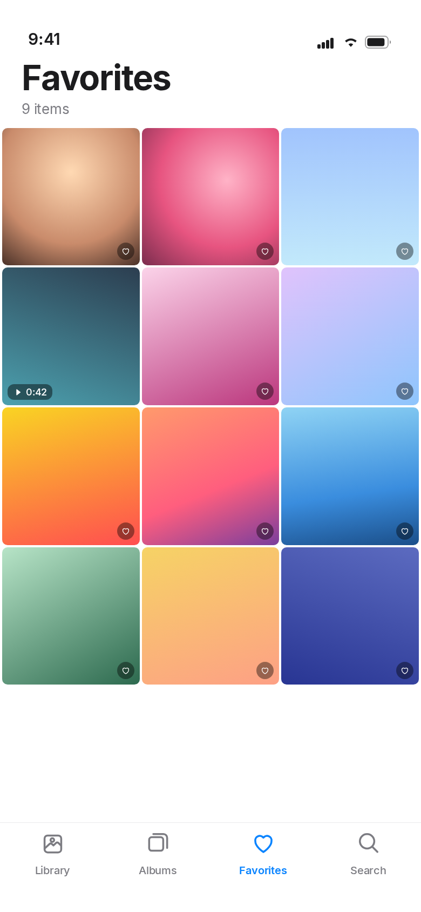

# iOS Gallery

A simple, private, **fully offline** photo and video gallery for Android, inspired by the
organisation and visual style of Apple's Photos app on iOS and macOS.

Kotlin · Jetpack Compose · Material 3 · MediaStore · Media3 · Coil — no server, no account,
no API key, no cloud, and **no `INTERNET` permission**.

> iOS Gallery is an independent project. It is not affiliated with, endorsed by, or
> connected to Apple Inc. The name and the flower mark are original artwork.

---

## Screens

| Library (light) | Library (dark) | Albums |
| --- | --- | --- |
|  |  |  |

| Search | Photo viewer | Selection mode |
| --- | --- | --- |
|  |  |  |



**About these images:** they are *design previews*, rendered from the same layout, spacing,
colour and type tokens the Compose UI uses. The build machine for this project has no KVM,
so no Android emulator could be booted to take true device screenshots. The app itself is
the real thing — build it or install the APK and you will see these screens with your own
photos in them.

---

## Install

**[Download the APK](https://github.com/technicalnihilist-lgtm/ios-gallery/releases/download/v1.0/iOS-Gallery-1.0.apk)**
— 9 MB, Android 7.0+ (the [v1.0 release](https://github.com/technicalnihilist-lgtm/ios-gallery/releases/tag/v1.0) page has it too).

```bash
adb install iOS-Gallery-1.0.apk
```

Or copy the file to the phone and open it, allowing "install unknown apps" when asked.

* Signed with the standard Android **debug key** (APK Signature Scheme v2), zip-aligned.
* It is a *release* build (`debuggable=false`), just signed with a development certificate.
  For Play Store distribution, sign it with your own keystore (see below).
* The APK is not committed to the repository — it lives on the release page, which keeps
  clone sizes small.

---

## Features

### Photos
* Automatic local scan through **MediaStore** (images + videos in one timeline).
* Evenly spaced, rounded iOS-style grid; lazy thumbnails with an in-memory + on-disk cache.
* Grouped by date: **Today**, **Yesterday**, then `12 March 2025`.
* Item count in the header (`1,248 photos · 36 videos`).
* Multi-select with Share / Favorite / Add to Album / Delete.

### Albums
* Every device folder appears automatically as an album, with cover thumbnail and count.
* Create, rename and delete **app-managed albums**.
* Add or remove photos from a managed album without ever touching the original file.

### Photo viewer
* Full-screen viewer with **pinch-to-zoom**, **double-tap zoom** and swipe navigation.
* Details sheet: file name, type, date, resolution, size, duration, folder.
* Share, copy, move, rename and delete through Android's own APIs:
  * **Share** — `ACTION_SEND` / `ACTION_SEND_MULTIPLE` with read grants.
  * **Copy / Move** — system folder picker (SAF), so you choose the destination.
  * **Rename** — `MediaStore` update, with `createWriteRequest` consent on Android 11+.
  * **Delete** — goes to Recently Deleted first (see below).

### Video
* Videos appear in the same grid, with duration badges and video-frame thumbnails.
* Playback with **Media3 ExoPlayer** and the native player controls (play/pause, seek,
  scrubbing, full-screen surface).

### Search
* Searches file names **and** album names, entirely on-device.
* Results split into Albums and Photos & Videos.

### Favorites
* Heart any photo or video; a dedicated Favorites tab shows them all.

### Recently Deleted
* Deleting moves an item into an app-managed trash area (a copy lives in the app's private
  storage) and then asks Android to remove the original.
* Restore puts it back into your library (`Pictures/iOS Gallery` or `Movies/iOS Gallery`).
* Delete Permanently, or Empty All, removes the app's copy for good.
* Anything older than 30 days is purged automatically.
* If the system confirmation is declined, the app rolls the trash entry back — nothing is
  left behind and nothing is lost.

---

## Privacy

| Question | Answer |
| --- | --- |
| Internet permission? | **None.** There is no `INTERNET` permission in the manifest, and the library-injected `ACCESS_NETWORK_STATE` is explicitly removed. |
| Accounts / login? | None. |
| Analytics / ads / trackers? | None. |
| Cloud sync / backup? | None. Backups and device transfer are disabled in the manifest. |
| Where is my media? | Exactly where it already was. The app only reads MediaStore. |
| What does the app write? | A small JSON index (favourites, albums, trash list) and thumbnail cache in its own private storage, plus a copy of items you delete. |

Permission handling:

| Android | Permission requested |
| --- | --- |
| 14–16 (API 34+) | `READ_MEDIA_IMAGES`, `READ_MEDIA_VIDEO`, `READ_MEDIA_VISUAL_USER_SELECTED` (supports "Select photos" partial access) |
| 13 (API 33) | `READ_MEDIA_IMAGES`, `READ_MEDIA_VIDEO` |
| 7–12L (API 24–32) | `READ_EXTERNAL_STORAGE` (+ `WRITE_EXTERNAL_STORAGE`, only needed to restore trashed items on those releases) |

If access is denied the app explains why, offers to ask again, and offers a shortcut to
system settings when the request can no longer be shown.

Works in airplane mode, always.

---

## Performance

* One MediaStore query per media type; no background services, no periodic jobs.
* Cursor columns are read defensively — a missing column or a revoked permission can't crash
  the scan (every query is wrapped and returns what it could read).
* Thumbnails are decoded at view size by Coil with a 20 % memory cache and a 200 MB disk cache.
* `LazyVerticalGrid` with stable keys and an adaptive column count, so thousands of items
  scroll without holding bitmaps in memory.
* The video player is created only for the visible page and released immediately.

---

## Build

Requirements: JDK 17, Android SDK Platform 35 + Build-Tools 35.0.0.

```bash
git clone <this repo>
cd iOS-Gallery
echo "sdk.dir=$HOME/Android/Sdk" > local.properties   # or set ANDROID_HOME
./gradlew assembleDebug        # app/build/outputs/apk/debug/app-debug.apk
./gradlew assembleRelease      # app/build/outputs/apk/release/app-release.apk
```

Signing your own release build:

```kotlin
// app/build.gradle.kts
signingConfigs {
    create("release") {
        storeFile = file("keystore.jks")
        storePassword = System.getenv("KEYSTORE_PASSWORD")
        keyAlias = System.getenv("KEY_ALIAS")
        keyPassword = System.getenv("KEY_PASSWORD")
    }
}
buildTypes { release { signingConfig = signingConfigs.getByName("release") } }
```

Then install:

```bash
adb install -r app/build/outputs/apk/release/app-release.apk
```

Notes:
* `isMinifyEnabled = false` — R8 shrinking is deliberately off so the build is quick and
  reproducible; the APK is ~9 MB either way.
* `lint { checkReleaseBuilds = false }` keeps release builds fast.
* `resourceConfigurations += listOf("en")` — the UI is English only, by design.

---

## Project layout

```
app/src/main/java/com/hubclub/iosgallery/
├── MainActivity.kt          app shell, permission gate, bottom navigation
├── GalleryApp.kt            thumbnail ImageLoader (memory + disk cache)
├── data/
│   ├── MediaRepository.kt   MediaStore scanning, device album grouping
│   ├── MetaStore.kt         favourites, managed albums, trash index (JSON)
│   └── FileOps.kt           share / copy / move / rename / delete / trash / restore
├── model/Models.kt          MediaItem, DeviceAlbum, ManagedAlbum, TrashEntry
├── ui/
│   ├── GalleryViewModel.kt  state + actions
│   ├── LibraryScreen.kt     timeline grid, date headers, selection mode
│   ├── AlbumsScreen.kt      albums, album detail, photo picker, dialogs
│   ├── FavoritesScreen.kt   favorites grid
│   ├── SearchScreen.kt      offline filename / album search
│   ├── ViewerScreen.kt      pager, pinch-zoom, video page, details sheet
│   ├── TrashScreen.kt       Recently Deleted
│   ├── Components.kt        grid, thumbnails, bottom bar, sheets
│   ├── GalleryIcons.kt      hand-built line icons (no icon-font dependency)
│   └── theme/Theme.kt       light / dark palettes and typography
└── util/                    permissions, formatting, date grouping
```

---

## Design notes

* Light and dark themes follow the system, with the iOS grouped-background palette
  (`#F2F2F7` light, `#1C1C1E` dark) and a single accent blue (`#0A84FF`).
* The tab bar and toolbars are translucent gradients with hairline separators — no real
  backdrop blur, which would cost frames on low-end devices.
* Icons are drawn as vector paths in code, so there is no icon-font dependency and every
  glyph matches the 1.7 dp stroke weight of the rest of the UI.
* The app icon is an original multicoloured flower / aperture mark, generated as an adaptive
  icon (with a monochrome layer for Android 13 themed icons) plus legacy raster fallbacks.

---

## Known limitations

* No device or emulator run was possible in the build environment (no KVM), so the UI has
  been verified by compilation, resource/manifest inspection and the rendered previews —
  not by tapping through it on hardware.
* Renaming or deleting files owned by another app requires the Android confirmation dialog;
  if it is declined the operation is cancelled cleanly.
* Restoring a trashed item on Android 7–12L needs write access, which the app requests on
  those releases only.
* The UI is English only.

---

## Licence

MIT — see [LICENSE](LICENSE).

Trademark note: iOS Gallery is an independent project and is not affiliated with, endorsed by
or connected to Apple Inc. "iOS", "iPhone", "iPad" and "macOS" are trademarks of Apple Inc.
The flower/aperture app icon is original artwork created for this project and is not Apple's
Photos icon.
